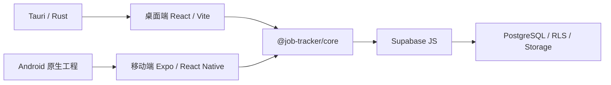

# 秋招投递助手（Job Hunting Tracker）

面向个人求职者的跨端投递管理工具。桌面端与移动端通过 Supabase 同步申请、招聘进展、地点标签和待跟进事项，当前基线版本为 v0.2.0。

## 功能

- 邮箱密码注册、登录、退出和会话恢复，业务数据由 Supabase RLS 按用户隔离。
- 管理待投递、已投递、笔试、多轮面试、Offer、拒绝等 13 种申请状态。
- 支持搜索、筛选、排序、统计、日历映射和待跟进提醒。
- 每条申请可关联多个地点标签和待跟进事项。
- 桌面端支持 JSON 导入以及 JSON/Excel 导出。
- 移动端支持申请管理、日历、头像、密码、主题和提醒偏好设置。

## 架构

```text
apps/
  desktop/                 Tauri + React + Vite 桌面应用
  mobile/                  Expo + React Native 移动应用及 Android 原生工程
packages/
  core/src/                跨端类型、常量、服务、统计、日期与导出逻辑
supabase/
  migrations/              PostgreSQL schema、迁移与 RLS
  rollbacks/               数据库迁移回滚脚本
docs/                      产品规格和设计记录
scripts/setup-windows.ps1  Windows 开发环境检查与安装脚本
```



关键边界：

- `apps/desktop/src/App.tsx` 是桌面工作台主入口；`apps/mobile/src/navigation/AppNavigator.tsx` 组织移动端业务页面。
- `@job-tracker/core` 是共享领域层。新业务规则优先放入 core，平台层只保留界面和适配逻辑。
- `supabase/migrations` 是数据结构和授权策略的最终来源，客户端只使用 anon/publishable key。
- 移动端设计令牌位于 `apps/mobile/src/theme.ts`，桌面端样式位于 `apps/desktop/src/styles.css`。

2026-07-29 的静态分析覆盖 116 个文件，生成 213 个实体节点、321 条关系和 79 条真实导入关系；27 个节点被标记为复杂。该快照用于识别维护热点，不代表运行时性能或测试覆盖率。

## 快速开始

### 环境要求

- Node.js 当前 LTS、`pnpm@9.12.0`
- 桌面原生构建：Rust stable、Tauri 2 所需 Windows 工具链
- Android 本地构建：JDK 17、Android SDK 35、Build Tools 35.0.0
- EAS 云构建：Expo/EAS 账号

Windows 可使用仓库脚本检查并安装环境：

```powershell
# 只检查，不修改电脑
powershell.exe -NoProfile -ExecutionPolicy Bypass -File .\scripts\setup-windows.ps1 -CheckOnly

# 安装缺失工具、项目依赖并运行验证；安装系统工具时需要管理员权限
powershell.exe -NoProfile -ExecutionPolicy Bypass -File .\scripts\setup-windows.ps1
```

可按需添加 `-SkipDesktop`、`-SkipAndroid`、`-SkipProjectInstall` 或 `-SkipVerification`。脚本不会填写真实 Supabase 密钥，也不会代替用户接受 Android SDK licenses。

### 安装与配置

```powershell
pnpm.cmd install --frozen-lockfile
Copy-Item .env.example apps/desktop/.env
Copy-Item .env.example apps/mobile/.env
```

在两个 `.env` 中填写同一 Supabase 项目的公开客户端配置：

```text
VITE_SUPABASE_URL=https://your-project.supabase.co
VITE_SUPABASE_ANON_KEY=your-anon-key
EXPO_PUBLIC_SUPABASE_URL=https://your-project.supabase.co
EXPO_PUBLIC_SUPABASE_ANON_KEY=your-anon-key
```

不要提交 `.env`、真实账号或 `service_role` key。EAS 云构建还需在对应项目环境中配置两个 `EXPO_PUBLIC_*` 变量。

### 启动项目

| 目标 | 命令 |
| --- | --- |
| 桌面 Web 调试 | `pnpm.cmd desktop:dev` |
| Tauri 桌面应用 | `pnpm.cmd desktop:tauri` |
| 移动端 Metro | `pnpm.cmd mobile:dev` |
| Android 模拟器 | `pnpm.cmd mobile:android` |
| Android 真机 | `pnpm.cmd mobile:android:device` |

移动端采用 Development Build：第一次或原生配置变化后运行 `mobile:android`/`mobile:android:device`；普通 TypeScript 和界面修改只需保持 `mobile:dev` 运行，即可使用 Fast Refresh。USB 调试出现 Metro 连接问题时可执行 `adb reverse tcp:8081 tcp:8081`。

## 验证与数据库

```powershell
pnpm.cmd typecheck
pnpm.cmd test
pnpm.cmd --filter @job-tracker/desktop build:check
```

项目目前没有 lint、formatter 或 CI，新增相关工具前应先更新工程规格。

数据库迁移按以下顺序应用：

1. `202605160001_initial_schema.sql`：profile、申请、事件和基础 RLS。
2. `202607250001_add_manager_status.sql`：增加 `manager` 状态。
3. `202607250002_mobile_workbench.sql`：地点标签、待跟进事项、个人偏好、头像策略和旧数据回填。

回滚脚本位于 `supabase/rollbacks/`。迁移和回滚必须先在隔离项目验证；所有业务表应保持 RLS 启用，并使用两个不同账号检查数据隔离。

桌面端 RLS 集成测试需要配置 `SUPABASE_TEST_URL`、`SUPABASE_TEST_ANON_KEY` 以及用户 A/B 的邮箱和密码变量；未配置时该测试会跳过。测试账号不得指向生产项目。

## 构建与发布

发布前运行类型检查和测试，并同步确认根包、`apps/desktop/src-tauri/tauri.conf.json`、`apps/mobile/app.json` 的版本信息。

| 产物 | 命令 | 输出 |
| --- | --- | --- |
| Windows NSIS 安装器 | `pnpm.cmd desktop:installer` | `apps/desktop/src-tauri/target/release/bundle/nsis/*.exe` |
| Windows 可执行文件 | `pnpm.cmd desktop:exe` | `apps/desktop/src-tauri/target/release/job-tracker-desktop.exe` |
| Android 测试 APK | `pnpm.cmd mobile:android:apk` | EAS 构建页面提供下载地址 |
| Android 发布 AAB | `pnpm.cmd mobile:android:aab` | EAS 构建页面提供下载地址 |

首次使用 EAS 前执行 `pnpm.cmd mobile:eas:login`。APK 用于直接安装测试，AAB 用于应用商店发布。

`dist/`、Tauri `target/` 和各类 Android `build/`/`.gradle/` 是可再生成产物，不应提交。`apps/mobile/android/` 本身是受版本控制的原生工程，不要整体删除。

## 在网页中查看知识图谱

知识图谱文件位于 `.understand-anything/knowledge-graph.json`。使用已安装 Understand Anything 插件的 Codex 或其他兼容 Agent 时：

1. 在项目根目录打开任务。
2. 在 Agent 对话中调用 `$understand-dashboard`（部分客户端显示为 `/understand-dashboard`）。这不是 PowerShell 命令。
3. 等待终端输出类似地址：

   ```text
   Dashboard URL: http://127.0.0.1:5173/?token=<ACCESS_TOKEN>
   ```

4. 在浏览器中打开完整地址，包括 `?token=...`；只打开无 token 的基础地址会进入访问令牌页面。

Dashboard 仅监听本机 `127.0.0.1`。端口被占用时会自动选择其他端口，以实际输出为准；结束对应任务或终端进程即可停止服务。

如果图谱不存在或代码已发生较大变化，先在 Agent 对话中调用 `$understand` 重新分析，再启动 Dashboard。相关产物包括：

- `.understand-anything/knowledge-graph.json`：完整知识图谱
- `.understand-anything/fingerprints.json`：增量分析指纹
- `.understand-anything/meta.json`：分析时间和 Git 基线

知识图谱是静态分析结果，不能替代 `typecheck`、测试或实际构建。

## 维护重点

1. 将 927 行的桌面 `App.tsx` 及多个超过 300 行的移动 Screen 按 feature 和 hooks 拆分。
2. 引入 ESLint、Prettier 和 CI，统一执行安装、类型检查、测试、桌面构建及 migration/RLS 验证。
3. 统一 v0.2.0 版本来源，为 Tauri 配置最小 CSP；使用原生 API 时再声明最小 capability。
4. 使用 Supabase 生成类型替代 `services.ts` 中的弱类型转换，并补充桌面工作台和移动端关键流程测试。
5. 按官方指南逐级升级 Expo SDK，每一步运行 `expo-doctor`、测试和原生构建。

参考资料：[Tauri CSP](https://v2.tauri.app/zh-cn/security/csp/)、[Supabase RLS](https://supabase.com/docs/guides/database/postgres/row-level-security)、[Expo SDK 升级指南](https://docs.expo.dev/workflow/upgrading-expo-sdk-walkthrough/)、[GitHub Actions Node.js 指南](https://docs.github.com/en/actions/tutorials/build-and-test-code/nodejs)。

## 规格与贡献

- 开发前阅读 [`docs/spec.md`](docs/spec.md)；移动工作台设计见 [`docs/ideas/mobile-workbench-v0.2.md`](docs/ideas/mobile-workbench-v0.2.md)。
- 保持 TypeScript 常量、共享类型和 PostgreSQL enum 一致。
- 不提交密钥、依赖目录、构建产物或本机代理/代码索引配置。
- 修改后至少运行与变更范围对应的类型检查、测试和构建检查。
